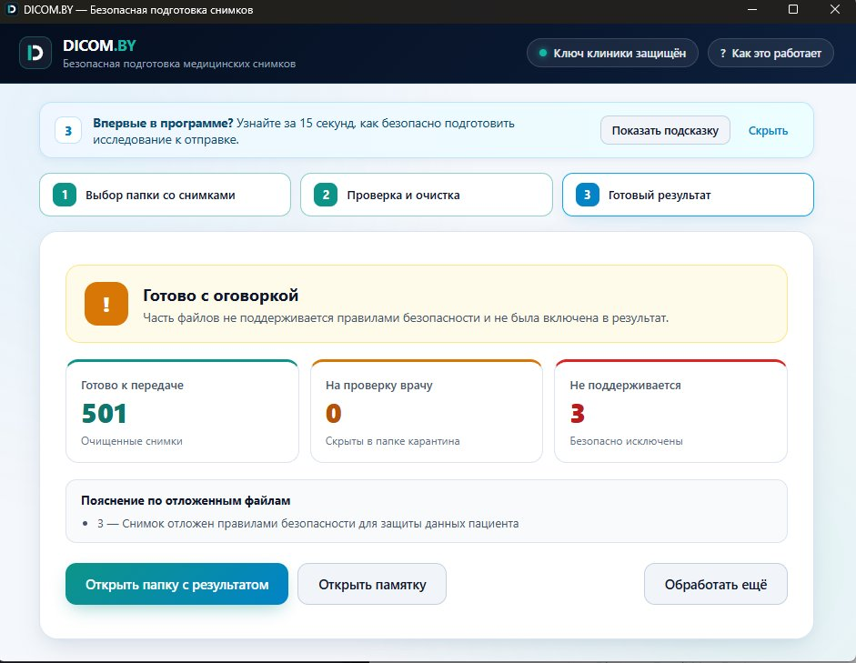

<p align="center">
  <picture>
    <source media="(prefers-color-scheme: dark)" srcset="docs/brand/dicom-by-logo-dark.svg" />
    <source media="(prefers-color-scheme: light)" srcset="docs/brand/dicom-by-logo.svg" />
    
  </picture>
</p>

<h3 align="center">Контрольная граница между медицинским архивом и внешним миром (DICOM PS 3.15 + OCR пикселей + Fail-Closed допуск)</h3>

<p align="center">
  <a href="https://dicom.by/"><b>dicom.by</b></a> •
  <a href="https://dicom.by/get-key/"><b>Получить бесплатный ключ</b></a> •
  <a href="#быстрый-старт-windows">Скачать для Windows</a> •
  <a href="#таблица-знаменателей-s6b-blind-test-и-g5m">Метрики и формулы S6B</a> •
  <a href="SECURITY.md">Безопасность</a>
</p>

<p align="center">
  
  
  
  
  
</p>

---

**DICOM.BY** — система контролируемого выпуска медицинских изображений на **C++17 + ONNX Runtime** для рабочего места врача, лаборанта или исследователя **без облачной передачи исследований**. Неизвестное не считается безопасным, непроверенное не выдаётся за доказанно чистое, а результат по каждому файлу оформляется проверяемым решением (`PROVEN`, `SCREENED`, `REVIEW` или `REFUSED`).

Этот репозиторий служит **открытым центром доверия и верификации DICOM.BY**: здесь публикуются бинарные релизы Windows, спецификация допуска [`standard/admission_v5.json`](standard/admission_v5.json), подписанный **Ed25519** реестр доказательств [`RELEASE_MANIFEST.json`](RELEASE_MANIFEST.json) (v2.0) и открытый независимый верификатор [`verify/dicom_by_verify.py`](verify/dicom_by_verify.py) (MIT). Исходный код проприетарного движка, OCR-каскада и словарей закрыт (см. [`LICENSE`](LICENSE)).

<p align="center">
  
</p>

## Ключевые особенности

- **Бесплатно для зарегистрированных пользователей (офлайн-ключ Ed25519):** получите бесплатный ключ на [**dicom.by/get-key/**](https://dicom.by/get-key/) и активируйте программу — далее обработка работает **полностью без интернета**. Опциональная проверка обновлений по HTTPS с `dicom.by` защищена криптографической подписью **Ed25519** и отключается в один клик для изолированных сетей.
- **Простой интерфейс для лаборанта и врача (`DICOM-BY.exe`, v0.4.3):** перетащите папку со снимками, посмотрите список отложенных файлов и при необходимости экспортируйте выпущенные объекты (`PROVEN` / `SCREENED`) в `.zip` для передачи по каналу, разрешённому политикой вашей организации.
- **Очистка впечатанного текста на изображениях (`Burned-in PHI`):** локальный каскад OCR + межкадровая проверка по всей серии с сохранением диагностических областей.
- **Строгий допуск `Fail-Closed` (`standard/admission_v5.json`):** 34 комбинации пиксельных форматов + 2 класса SR-отчётов. Неподдерживаемые и рискованные объекты не выпускаются «молча», а уходят в `_quarantine` (`REVIEW`) или `REFUSED`.
- **Независимый контроль целостности (`dicom-verify` и `verify/dicom_by_verify.py`):** для каждого объекта создаётся `.deid.json` / `.refused.json` с HMAC-SHA-256 (`seal`) и проверкой SHA-256 выходного DICOM.

---

## Быстрый старт (Windows)

1. Получите бесплатный регистрационный ключ на странице [**dicom.by/get-key/**](https://dicom.by/get-key/).
2. Скачайте **`DICOM-BY-0.4.3-Setup.exe`** со страницы [**Releases**](../../releases) (или с [dicom.by](https://dicom.by/)).
3. Запустите установщик (права администратора не обязательны) и вставьте выданный ключ `DICOMBY-1....` — после этого подключение к сети не требуется.
   > **Примечание о Windows SmartScreen:** пока установщик распространяется без коммерческого EV-сертификата подписи кода, Windows при первом запуске может показать предупреждение *«Система Windows защитила ваш компьютер»* — нажмите **«Подробнее → Выполнить в любом случае»** и при желании проверьте `SHA-256` по [`SHA256SUMS.txt`](../../releases/latest/download/SHA256SUMS.txt):
   > ```powershell
   > Get-FileHash .\DICOM-BY-0.4.3-Setup.exe -Algorithm SHA256
   > ```
4. Перетащите папку исследования (КТ/МРТ/УЗИ/рентген) и нажмите **«Начать обезличивание»**.
5. При необходимости соберите `.zip` только из выпущенных объектов (`PROVEN` / `SCREENED`) кнопкой **«Упаковать в ZIP»**.

---

## Desktop Free vs Gateway Pro

| Возможность | Desktop Free (`0.4.3`, бесплатно по ключу) | Gateway Pro / OEM (`0.4.0+`, коммерческая лицензия) |
|---|---|---|
| Настольное приложение Windows (`DICOM-BY.exe`, `0.4.3`) | Бесплатно (офлайн-ключ Ed25519) | Включено |
| Автономное CLI-ядро (`dicom-anon`, `0.4.0`) и верификатор (`dicom-verify`) | В составе установки | Включено |
| Открытый независимый верификатор (`verify/dicom_by_verify.py`) | Открытый код (`MIT`) | Открытый код (`MIT`) |
| **`DICOM.BY Gateway Pro`** (PACS `C-STORE SCP/SCU`, служба Windows SCM, очередь `_retry`, аудит-цепь) | — | Коммерческая лицензия |
| **OEM / SDK-встраивание** и **Пакет внедрения** (GPO, SLA, протокол пилота) | — | По договору |

---

## Таблица знаменателей (`S6B-BLIND-TEST` и `G5M`)

Слепой контрольный прогон ядра `0.4.0` (`admission_v5`) на закрытом корпусе **MIDI-B Synthetic Test** (`29 660` валидных DICOM, `428` серий, `322` пациента; полный протокол — на [dicom.by/evidence/](https://dicom.by/evidence/)):

- **Итоги маршрутизации:** **`28 605`** выпущено (`SCREENED`/`PROVEN`), **`953`** переведено в `_quarantine` (`REVIEW`), **`102`** отклонено структурными фильтрами (`4` серии со сбойным `(0004,1500)`, обрывом до EOF или `HighBit`; **`0` отказов по таблице форматов `admission_v5`**), ошибок движка — **`0`**.

| Метрика | Формула и числитель / знаменатель | Результат | Что измеряет |
|---|---|---|---|
| **Доля проверок серий (`all`)** | `174 801 / 178 820` (по всем 428 сериям) | **`97,75 %`** | Включены все обработанные объекты, включая карантин `REVIEW` и 4 серии со структурным `REFUSED` |
| **Доля проверок серий (без `REFUSED`)** | Исключены 4 серии со структурным отказом (остаётся 424 серии) | **`98,16 %`** | Точность обработки по всем допустимым сериям корпуса |
| **Доля проверок объектов (`all`)** | `7 864 280 / 8 035 948` | **`97,86 %`** | Доля пройденных проверок ключа на уровне отдельных инстансов |
| **Доля выпущенных наружу (`released`)** | Только каталог автовыпуска (`28 605` файлов; 953 `REVIEW` отсутствуют) | **`80,79 %`** сер. / **`95,26 %`** инст. | Показывает цену осознанной остановки спорных случаев в `_quarantine` (без серий `REVIEW`/`REFUSED` — **`98,20 %`**) |
| **Новые ошибки `dciodvfy`** | Снижение с `39` на `298` контрольных объектах | **`0 / 298`** (`0 / 295`) | Отсутствие новых структурных нарушений стандарта DICOM |
| **Утечки скрытых пикселей** | `<pixels_hidden>` во внешней выдаче (`13` закрыто, `14` в `REVIEW`) | **`0`** | Ни один скрытый пиксельный PHI не попал в автовыпуск |
| **HIPAA на выдаче (`Z` vs `B`)** | `HIPAA_Z = 0 / 1 116 405`; сохранился **`1 / 697 264` `HIPAA-B`** | **К2 FAIL** (`HIPAA-B`) | Пропуск 1 элемента (`prev_cat = ['patient_address', 'comment']`) честно сохранён по протоколу K5 |
| **Сохранность клин. меток (`G5M`)** | `872 / 1 101` на 1 687 снимках TCIA (порог `≥ 80 %`) | **`79,2 %` (FAIL)** | Честное ограничение OCR при 100 % скрытии PHI ≥ 12 px (`98,9 %` < 12 px) и `0,89 %` ложных заливок |

---

## Независимая верификация (MIT)

Любая организация может проверить подлинность реестра доказательств [`RELEASE_MANIFEST.json`](RELEASE_MANIFEST.json), матрицы [`standard/admission_v5.json`](standard/admission_v5.json), сертификатов `.deid.json` и журналов шлюза открытым Python-скриптом [`verify/dicom_by_verify.py`](verify/dicom_by_verify.py):

```bash
pip install cryptography
python verify/dicom_by_verify.py --evidence RELEASE_MANIFEST.json --admission standard/admission_v5.json
python verify/test_verify.py
```

---

## Правовые документы и источники

- [LICENSE](LICENSE) — условия Freeware (Desktop по ключу) + лицензия `MIT` для `verify/` и `standard/admission_v5.json`
- [COMMERCIAL_LICENSE.md](COMMERCIAL_LICENSE.md) — условия для `Desktop Free` и `Gateway Pro / OEM`
- [DATA_SOURCES.md](DATA_SOURCES.md) — происхождение словарей и таблиц (DICOM PS3.15/3.16, RadLex v2.1 adaptation, TCIA Data Usage Policy / PTKB, US Census 2010, OpenCorpora, bnkorpus, UCUM, Wikidata)
- [THIRD_PARTY.md](THIRD_PARTY.md) — перечень сторонних библиотек C++ в поставке Windows
- [SECURITY.md](SECURITY.md) — политика безопасности, подпись `Ed25519` и правила уведомления об уязвимостях
- [CHANGELOG.md](CHANGELOG.md) — история релизов
